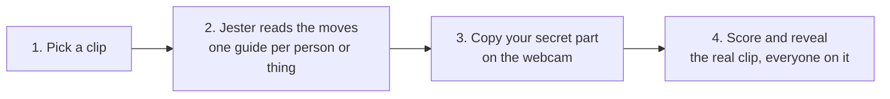

# Jester

**Any video is now a game.** Everyone gets a secret part from a clip, copies it on their webcam without seeing the video, and then the real clip plays with all of you on top of it.

Built at HackPrinceton Fall 2026 (November 13 to 15). Main track: **Entertainment**.

**Play it:** https://jester-pi.vercel.app (a laptop with a webcam, in desktop Chrome or Edge [check])

<!-- PICTURE SLOT: hero. Use the hero picture from app/public/devpost/ once the devpost kit pull request is merged. Real screenshot only. -->

## Any video is now a game

- **Any clip becomes a level.** Jester finds the people (up to 4) and the things that move in a short video (a dancer, a dog, a ball) and turns each one into a part someone can play. No level design, no markers, no training.
- **You play blind.** Each player sees only their own part's outline or stick figure, never the clip and never who they are. You find out what you actually did at the reveal.
- **The reveal is the payoff.** The real video plays with every player's cutout on their part, the jester crowns the winner, and the reveal saves as a video you can keep.

## How it works



<!-- PICTURE SLOT: round diagram. If the devpost kit's app/public/devpost/diagram-round.png is merged, it can go here beside or instead of the diagram above. -->

1. **Pick a clip.** From the video bank, or a file from your computer. While the bank is empty the game offers two built-in starter clips, which also work offline.
2. **Jester reads the moves.** The clip side finds up to 4 people per frame and the things that move, notices cuts, follows each subject through the clip, and writes a guide for each: the pose over time (33 body points), the box over time and an outline. A clip it cannot use is refused with a sentence a player can read.
3. **Copy your secret part.** Pass the laptop, or play online with a room code, each on your own device. You see only your part's shape and pick how to copy it: with your whole body, or with one hand or your head following it. Slower speeds (0.75 and 0.5) are scored in the clip's own time.
4. **Score and reveal.** The engine scores each copy from 0 to 100 limb by limb, then the reveal plays: a title card, the cast over the clip, the busiest few seconds beside the original, and a cast card with every score.

<!-- PICTURE SLOT: a blind turn (the outline a player copies) and the reveal (players over the real clip). Real screenshots only. -->

## What each part does

| Part | Where | What it does | Tests |
|---|---|---|---|
| Clip side | `clip/`, `app/src/clipside/` | Reads the video's frames, finds people (MediaPipe Pose Landmarker) and moving things (EfficientDet-Lite0), detects cuts, follows and rejoins each subject, ranks them, refuses clips it cannot use, and turns each subject into a guide. Saved under a fingerprint of the file, so the same video gives the same result. | 103 |
| Webcam side | `spikes/pose-match/webcam.mjs` and its helpers | Tracks the player's 33 body points live, smooths them (One Euro filter), and keeps a person mask and outline for the reveal cutout. | 53 |
| Engine | `engine/` | Scores a copy: 12 limb directions (so height, size and distance do not matter), the player mirrored, one lag for the round, and credit only for accuracy that beats standing still or for moving the way the clip moves, so standing still scores near 0. Things are scored by how the player's body follows the thing's box. Same inputs, same score, bit for bit. | 70 |
| Rooms | `spikes/pose-match/rooms.mjs`, `app/src/ui/room.ts`, `app/src/supabaseTransport.ts` | Four letter room codes over Supabase Realtime: presence, host handoff, a start synced to the host's clock, late joiners sit out one round, shared results. | 13 |
| Eval | `eval/`, `app/round-log-plugin.ts` | Records every scored round (pose points only, no video) and replays them all against the engine on disk, so a scoring change shows what got better or worse. | 8 |
| Game | `app/` | The screens, the look, blind mode, online play and the recorded reveal. Vite and TypeScript. | typecheck and build |

247 tests in all, every one passing on main (`make test`, run Nov 14). Lab pages that try one part at a time on the dev server are listed in [`docs/labs.md`](docs/labs.md).

## Challenges

- **Fair scores on gentle clips.** The first blind mode games scored everyone 0. The engine paid only for accuracy above what standing still earns, and on a slow dance standing still already earns 0.80 to 0.85. Engine 0.9.0 also gives plain accuracy credit, but only as far as the player's limbs turn the way the clip's do, so a still body still scores near 0 (`engine/test/fairness.test.ts`).
- **Following everyone in a group dance.** In video mode the pose tracker only looks for new people when it loses one, so in a tight four person dance it followed two. Jester now looks on every frame and rejoins a subject's pieces up to 3 seconds apart, near where the last piece was heading and at a similar size.
- **Starting together on different laptops.** Each device measures how far its clock is from the host's (ping and reply, lowest delay wins), so "start at T" is the same moment everywhere. A player silent for 10 seconds is dropped and the next one becomes host.
- **A link instead of a file, without taking the video.** YouTube does not let a page copy its frames. The link lab shares the tab, cropped to the player, reads each frame once for people and drops it. Only the moves are kept.

## Run it

Needs Node 22.18 or newer (the tests run TypeScript directly) and npm.

```bash
git clone https://github.com/aaron-sulbaran/jester.git
cd jester
make setup
make dev
```

Then open http://localhost:5173. No settings file is needed: the dev server takes the two public Supabase settings from the live site by itself, and without a network the game still runs in one browser. Every setting is named in [`app/.env.example`](app/.env.example). Add `?nocam=1` to play with simulated players and no camera [check].

`make test` runs the type checks and all 247 tests, `make build` builds the game into `app/dist`, and `make help` lists the targets. Each folder's README goes deeper: [`app/`](app/README.md), [`engine/`](engine/README.md), [`clip/`](clip/README.md), [`eval/`](eval/README.md).

## Team and how we built it

- **Aaron Sulbaran** ([aaron-sulbaran](https://github.com/aaron-sulbaran)): the clip side and the look.
- **Lisa Hadi** ([lisahadi](https://github.com/lisahadi)): the webcam side and rooms.
- **Alex Huang** ([alexx0711](https://github.com/alexx0711)): the scoring engine and the game's rules.

**AI tools.** Each of us worked with Claude Code (Claude Opus 5.5, Sonnet 5.5 and Fable 5.2); commits written with it carry a `Co-Authored-By` line naming the model. The game calls no language model: every number comes from the pose and object models running in the browser and from fixed code.

**How we built this.** Three people each ran several coding agents at once, so the repo carries its own rules for them. [`AGENTS.md`](AGENTS.md) at the root is what every agent reads first, whatever tool it runs in: how to tell the team which files it is about to touch and what it changed, to commit only as its own person, and that anything a player sees goes through one look. [`CLAUDE.md`](CLAUDE.md) is one line that points Claude Code at the same file, so there is a single copy of the rules. Agents worked on their own branches, and each part has a pure, tested core (`clip/`, `engine/`, the webcam and room modules) that the app imports, which kept parallel work from breaking each other.

## Credits

- Pose tracking and object detection: [MediaPipe Tasks Vision](https://ai.google.dev/edge/mediapipe/solutions/guide) from Google (Pose Landmarker, and the Object Detector with EfficientDet-Lite0), loaded in the browser.
- Video frames: [Mediabunny](https://mediabunny.dev). Rooms, clip submissions and the shared round log: [Supabase](https://supabase.com). Build: [Vite](https://vite.dev) and TypeScript.
- Links: the [YouTube IFrame Player API](https://developers.google.com/youtube/iframe_api_reference) and the browser's own tab capture.
- Smoothing: the One Euro Filter (Casiez, Roussel and Vogel, CHI 2012).
- Fonts: Gaegu, Shantell Sans, Special Elite and Titan One, from Google Fonts under open licenses.
- The jester: drawn procedurally in Blender by [`art/jester/jester.py`](art/jester/jester.py).

## Clips

- No video files live in this repo. It holds motion data and code only.
- The public bank holds only clips we may share: filmed by the team, public domain, or openly licensed and credited on the clip [check]. The files are copied in at deploy time and never committed.
- Links are never downloaded. Jester reads each captured frame once for people and drops it; no tool or service that fetches video from YouTube, TikTok or Instagram is used.
- Submit your own: a clip goes to a private bucket and a person on the team reviews it before it can join the bank. The sender confirms they filmed it and everyone in it agrees.
- The round log keeps pose points, the score, and the camera and engine details. No video, no images, no masks.
